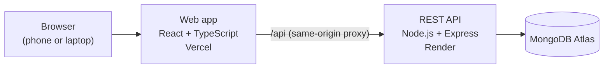

<div align="center">

# Sabaq · سبق

**Your semester, in one calm place.**

One structured place for every deadline, announcement and submission rule, so students stop missing deadlines and stop losing marks to avoidable mistakes.

[](docs/01-module-plans.md)
[](#roadmap)
[](LICENSE)

[Vision](docs/00-vision-and-plan.md) · [Build plan](docs/01-module-plans.md) · [Roadmap](#roadmap) · [Contributing](CONTRIBUTING.md)

</div>

---

> [!NOTE]
> Sabaq is being built in public, one module at a time, as the semester project for **Human Computer Interaction (SE3223)** at Riphah International University, Fall 2026.
> This README only describes what exists in the repository. The live app link will appear here once it is deployed (Module 16).

## The problem

Course information is scattered across WhatsApp class groups, the university LMS (Moellim) and PDF lab manuals. As a result:

- announcements get buried in chat, so deadlines are missed or discovered late;
- submission rules such as `Lab11_SAPID_CS5-1` live on page 2 of a PDF, and a wrong file name can cost 10% of the marks;
- nobody, student or instructor, can see when several courses' deadlines pile up on the same day;
- whoever posts an announcement never knows whether the class actually saw it.

In HCI terms: students face a wide **gulf of evaluation** (they cannot see the state of their semester) and the system offers **no error prevention** (mistakes are found only after marks are lost).

## The solution

| Feature | What it does |
| --- | --- |
| **Today and Timeline** | Every deadline, quiz and class across all courses, ordered by urgency |
| **Structured Announcements** | One post by a CR or instructor becomes a deadline in every student's timeline |
| **"Seen by" receipts** | Senders know how many students have seen each announcement |
| **Paste-to-Structure Assistant** | Paste a WhatsApp-style message; Sabaq drafts a structured announcement to confirm |
| **Submission Checker** | Checks a file's name, type, size and timing against the assignment's rules *before* upload, right in the browser |
| **Workload Heatmap and Clash Warning** | Shows crunch days; warns instructors when a new deadline lands on an already busy day |
| **Planner** | Drag tasks into study slots, with a full keyboard alternative |
| **Study Group Finder** | Find or form study groups per course |
| **Focus mode and personalization** | Quiet hours, light, dark and high-contrast themes, font size, density, English and Urdu |

### What is new

Learning management systems, calendars and to-do apps already exist, but none of them:

1. turn **one** announcement into a correct deadline for the **whole class**;
2. check **submission rules before upload**;
3. warn instructors about **deadline clashes across courses**;
4. accept **the way classes already communicate** (pasted chat messages);
5. tell senders **who has actually seen** an announcement.

Read the full reasoning in the [product vision](docs/00-vision-and-plan.md).

## Who it is for

| Role | Uses Sabaq to |
| --- | --- |
| **Students** (primary) | See what is due, submit correctly, plan their week, find study partners |
| **CRs** (secondary) | Post announcements once instead of answering the same questions repeatedly |
| **Instructors** (secondary) | Set deadlines with clear rules, avoid overloading the class, confirm information arrived |
| **Admins** | Manage programs, classes and users |

## Built on HCI principles

Sabaq follows a user-centered design process (ISO 9241-210) across six phases: user research → ideation → low-fidelity prototyping → formative testing → high-fidelity iteration → summative evaluation. Every phase is documented in [`docs/`](docs/README.md), and every major design decision is recorded as a QOC (Question–Option–Criteria) design-rationale record.

## Architecture



| Layer | Technology |
| --- | --- |
| Frontend | React, TypeScript, Vite, Tailwind CSS, Radix UI, TanStack Query, i18next |
| Backend | Node.js, Express, TypeScript, Zod |
| Database | MongoDB Atlas with Mongoose |
| Shared | Zod schemas and domain logic used by both frontend and backend |
| Testing | Vitest, Supertest, Playwright, axe-core |
| Hosting | Vercel (web), Render (API), MongoDB Atlas (data) |

## Repository structure

```text
Sabaq/
├── apps/
│   ├── web/          React frontend
│   └── api/          Express backend
├── packages/
│   └── shared/       Types, validation schemas and domain logic
├── docs/             Research, design, design rationale, testing, style guide
└── .github/          Workflows and templates
```

## Getting started

The development toolchain is introduced in Module 03; setup instructions will appear here then.

Requirements: **Node.js 22 LTS** or newer (see [`.nvmrc`](.nvmrc)) and Git.

## Roadmap

Sabaq is built in 30 verified modules. Each module is committed and pushed on its own. Details are in the [build plan](docs/01-module-plans.md).

**Phase 0 · Foundation**

- [x] M01 · Repository foundation
- [ ] M02 · Research kit
- [ ] M03 · Monorepo tooling and CI
- [ ] M04 · Shared domain package

**Phase A · Backend core**

- [ ] M05 · API scaffold
- [ ] M06 · Database models and seed data
- [ ] M07 · Authentication API

**Phases 1–4 · Research and design**

- [ ] M08 · Research synthesis
- [ ] M09 · Personas, goals, task analysis, usability targets
- [ ] M10 · Ideation, concepts, design rationale
- [ ] M11 · Information architecture and low-fidelity prototype
- [ ] M12 · Formative usability testing, round 1

**Phase B · Frontend foundation**

- [ ] M13 · Design system and style guide
- [ ] M14 · Web app scaffold and app shell
- [ ] M15 · Authentication screens
- [ ] M16 · Deployment pipeline

**Phase C · Features**

- [ ] M17 · Classes and membership
- [ ] M18 · Onboarding, profile and personalization
- [ ] M19 · Structured announcements and receipts
- [ ] M20 · Paste-to-structure assistant
- [ ] M21 · Today and Timeline
- [ ] M22 · Submission Checker
- [ ] M23 · Workload heatmap and clash warning
- [ ] M24 · Planner
- [ ] M25 · Study Group Finder
- [ ] M26 · Notifications and focus mode
- [ ] M27 · Power features and polish

**Phase D · Quality and evaluation**

- [ ] M28 · Hardening: accessibility, testing, security, performance
- [ ] M29 · Round 2 testing and summative evaluation
- [ ] M30 · Portfolio, presentation and v1.0.0 release

## Academic context

| | |
| --- | --- |
| Course | Human Computer Interaction (SE3223), BS Computer Science, Semester 5 |
| Institution | Riphah International University, Faculty of Computing |
| Session | Fall 2026 |
| Instructor | Muhammad Shabbir Hassan |

## Contributing

See [CONTRIBUTING.md](CONTRIBUTING.md). Usability problems are bugs too: please report them with the **Usability finding** issue template.

## License

[MIT](LICENSE) © 2026 Muhammad Taimoor Ajmal
