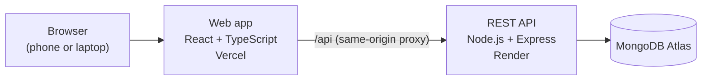

<div align="center">

# Sabaq · سبق

**Your semester, in one calm place.**

An open-source academic companion that brings every deadline, announcement and submission rule into one structured place, so students stop missing deadlines and stop losing marks to avoidable mistakes.

[](https://github.com/muhammadtaimoorajmal/Sabaq/actions/workflows/ci.yml)
[](docs/roadmap.md)
[](#roadmap)
[](LICENSE)

[Vision](docs/vision.md) · [Roadmap](docs/roadmap.md) · [Documentation](docs/README.md) · [Contributing](CONTRIBUTING.md)

</div>

---

> [!NOTE]
> Sabaq is under active development and is not usable yet. This README only describes what already exists; the live app will be linked here once it is deployed.

## Why Sabaq

Course information usually arrives through channels that were never designed for it: chat groups, the learning management system (LMS), PDF handouts and verbal reminders. The result:

- **Announcements get buried.** A deadline posted in a busy chat group is easy to miss.
- **Rules hide in documents.** File-naming rules such as `Lab11_<StudentID>_<Section>` sit inside a PDF, and a wrong name can cost marks.
- **Workload is invisible.** Nobody, student or instructor, can see when several courses pile deadlines onto the same day.
- **Senders fly blind.** Whoever posts an announcement never knows whether the class actually saw it.

## What Sabaq does

| Feature | What it does |
| --- | --- |
| **Today and Timeline** | Every deadline, quiz and class across all courses, ordered by urgency |
| **Structured Announcements** | One post by a class representative or instructor becomes a deadline in every student's timeline |
| **"Seen by" receipts** | Senders see how many students have seen each announcement |
| **Paste-to-Structure Assistant** | Paste a chat-style message; Sabaq drafts a structured announcement for you to confirm |
| **Submission Checker** | Checks a file's name, type, size and timing against the assignment's rules before upload, entirely in the browser |
| **Workload Heatmap and Clash Warning** | Shows crunch days, and warns instructors when a new deadline lands on an already busy day |
| **Planner** | Drag tasks into study slots, with a full keyboard alternative |
| **Study Group Finder** | Find or form study groups for each course |
| **Focus and personalization** | Quiet hours; light, dark and high-contrast themes; text size; density; multiple languages including right-to-left |

### What makes it different

Learning management systems, calendars and to-do apps already exist, but none of them:

1. turn **one** announcement into a correct deadline for the **whole class**;
2. check **submission rules before upload**;
3. warn instructors about **deadline clashes across courses**;
4. accept **the way classes already communicate** (pasted chat messages);
5. tell senders **who has actually seen** an announcement.

Read the full reasoning in the [product vision](docs/vision.md).

## Who it is for

| Role | Uses Sabaq to |
| --- | --- |
| **Students** | See what is due, submit correctly, plan the week, find study partners |
| **Class representatives** | Post announcements once instead of answering the same questions again and again |
| **Instructors** | Set deadlines with clear rules, avoid overloading the class, confirm information arrived |
| **Admins** | Manage programs, classes and users |

## Designed with users, not just for them

Sabaq follows a user-centered design process: field research → personas and task analysis → competing concepts → low-fidelity prototypes → usability testing → iteration → a measured benchmark against today's workflow. Research instruments, findings, design decisions and test results are all published in [`docs/`](docs/README.md).

Accessibility is a requirement, not a feature: every screen is built to work with a keyboard alone, with screen readers, at 200% zoom, in high contrast and in right-to-left languages.

## Architecture



| Layer | Technology |
| --- | --- |
| Frontend | React, TypeScript, Vite, Tailwind CSS, Radix UI, TanStack Query, i18next |
| Backend | Node.js, Express, TypeScript, Zod |
| Database | MongoDB Atlas with Mongoose |
| Shared | Zod schemas and domain logic used by both frontend and backend |
| Testing | Vitest, Supertest, Playwright, axe-core |
| Hosting | Vercel (web), Render (API), MongoDB Atlas (data) |

## Repository structure

```text
Sabaq/
├── apps/
│   ├── web/          React frontend
│   └── api/          Express backend
├── packages/
│   └── shared/       Types, validation schemas and domain logic
├── docs/             Vision, roadmap, research, design, decisions, testing
└── .github/          Workflows and templates
```

## Getting started

**Requirements:** [Node.js](https://nodejs.org/) 22.12 or newer (see [`.nvmrc`](.nvmrc)) and Git.

```bash
git clone https://github.com/muhammadtaimoorajmal/Sabaq.git
cd Sabaq
npm install        # also installs the Git hooks
npm run dev        # the API on :4000 and the web app on :5173
npm run check      # everything CI runs: format, lint, docs, types, tests
```

| Script | What it does |
| --- | --- |
| `npm run dev` | Starts the API and the web app together |
| `npm run dev:api` | Starts the API at `http://localhost:4000` with automatic restarts and a temporary demo database |
| `npm run dev:web` | Starts the web app at `http://localhost:5173` |
| `npm run check` | Runs every check below, exactly as continuous integration does |
| `npm run format` | Formats code and configuration with Prettier |
| `npm run lint` | Lints code with ESLint, including accessibility rules for interface files |
| `npm run lint:md` | Lints the documentation with markdownlint |
| `npm run lint:links` | Verifies that every link and heading anchor in the documentation resolves |
| `npm run lint:research` | Checks that every research insight cites at least two independent sources |
| `npm run typecheck` | Type-checks with TypeScript in strict mode |
| `npm run test` | Runs all tests with coverage (domain logic must stay at 100%) |
| `npm run test:e2e` | Runs the end-to-end tests in a real browser: user journeys, keyboard access, accessibility scans with color contrast, small screens and Lighthouse |
| `npm run build` | Builds every workspace package |
| `npm run research:survey` | Validates the survey export and writes the analysis with charts and hypothesis verdicts |

The API, its database and authentication are in place ([`apps/api`](apps/api/README.md), [data model](docs/data-model.md)), and so is the web app's [design system](docs/design-system/README.md), app shell and account screens ([`apps/web`](apps/web/README.md)): create an account, confirm the e-mail address, sign in (or use a demo account), recover a forgotten password, change the password and manage signed-in devices; create a class, invite with a code, link or QR code, join in seconds, manage members, roles and courses; a short welcome after sign-up; profile and photo; display, time and notification settings that follow you to every device; download your data or delete your account; structured announcements (deadlines become tasks for the whole class), an inbox with unread counts, edit history and live "seen by" receipts; paste a chat message to draft an announcement, with every detected detail highlighted for checking; Today (next deadline, overdue, due today, today's classes with cancellations and room changes) and a timeline in list, week and month views; personal tasks; mark as done with undo; works offline after the first visit; a Submission Checker that checks a file's name, type, real content, size and timing against the task's rules in the browser, before submitting, with the exact fixes; a workload calendar and table for each person and class, and a warning with lighter days when a new due date lands on a busy day. No database or e-mail setup is needed for development. Product screens arrive in the next milestones; see the [roadmap](#roadmap).

## Roadmap

Sabaq is built in 30 milestones, each verified before release. Details are in the [roadmap](docs/roadmap.md).

**Foundation**

- [x] M01 · Repository foundation
- [x] M02 · User research kit
- [x] M03 · Tooling and continuous integration
- [x] M04 · Shared domain package

**Backend core**

- [x] M05 · API scaffold
- [x] M06 · Database
- [x] M07 · Authentication API

**Research and design**

- [ ] M08 · Research synthesis (analysis tools ready; awaiting fieldwork data)
- [ ] M09 · Personas, goals, task analysis, usability targets
- [ ] M10 · Ideation and concept selection
- [ ] M11 · Information architecture and low-fidelity prototype
- [ ] M12 · Formative usability testing

**Frontend foundation**

- [x] M13 · Design system
- [x] M14 · App shell
- [x] M15 · Authentication screens
- [ ] M16 · Deployment

**Features**

- [x] M17 · Classes and membership
- [x] M18 · Onboarding, profile and personalization
- [x] M19 · Structured announcements and receipts
- [x] M20 · Paste-to-structure assistant
- [x] M21 · Today and Timeline
- [x] M22 · Submission Checker
- [x] M23 · Workload heatmap and clash warning
- [ ] M24 · Planner
- [ ] M25 · Study Group Finder
- [ ] M26 · Notifications and focus mode
- [ ] M27 · Power features and polish

**Quality and launch**

- [ ] M28 · Hardening
- [ ] M29 · Usability benchmark
- [ ] M30 · Launch v1.0.0

## Contributing

Contributions are welcome; see [CONTRIBUTING.md](CONTRIBUTING.md). Usability problems count as bugs: report them with the **Usability finding** issue form.

## License

[MIT](LICENSE) © 2026 Muhammad Taimoor Ajmal
