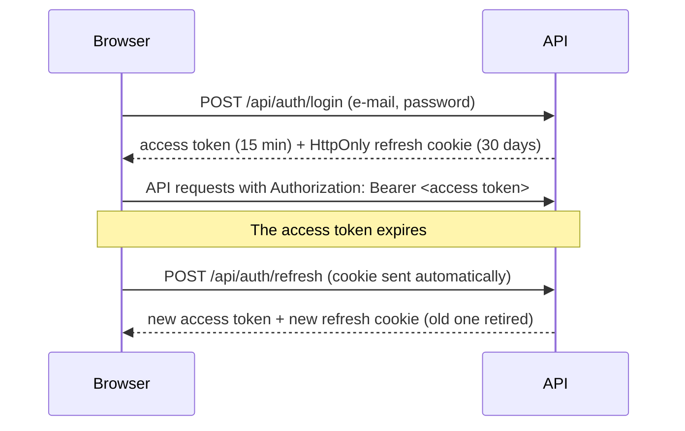

# @sabaq/api

The Sabaq REST API: Node.js, Express 5 and TypeScript. It shares its validation schemas and domain logic with the web app through [`@sabaq/shared`](../../packages/shared/README.md).

> [!NOTE]
> The server, database and authentication are in place; feature endpoints arrive with each feature. See the [roadmap](../../docs/roadmap.md).

## Running locally

From the repository root:

```bash
npm install
npm run dev:api      # http://localhost:4000, restarts on every change
```

No database or account is needed: without `MONGODB_URI`, development mode starts a temporary MongoDB on your computer and fills it with [demo data](../../docs/data-model.md#demo-data). The first start downloads MongoDB once (it is cached afterwards); changes are lost when the server stops.

To use a persistent database, follow the [MongoDB Atlas guide](../../docs/guides/mongodb-atlas.md) and copy [`.env.example`](.env.example) to `.env`. Development mode reads `@sabaq/shared` straight from its TypeScript sources, so changes there apply immediately without a build.

| Command (from the repository root) | What it does |
| --- | --- |
| `npm run dev:api` | Starts the API with automatic restarts and readable logs |
| `npm run build` | Compiles every package, including the API, to `dist/` |
| `npm start -w @sabaq/api` | Runs the compiled API, as in production |
| `npm run db:seed -w @sabaq/api` | Loads the demo institution into the database in `MONGODB_URI` (add `-- --reset` to replace existing Sabaq data) |
| `npm test` | Runs all tests with coverage |

## Endpoints

| Method and path | Purpose |
| --- | --- |
| `GET /api/health` | **Liveness.** Answers instantly without touching any dependency, so the web app can also use it to wake a sleeping server |
| `GET /api/health/ready` | **Readiness.** Pings the database and answers `503` when it is unreachable |
| `GET /api` | Name and version of the API |
| `GET /api/dev/mail` | **Development only.** The e-mails the API would have sent (newest first; filter with `?to=`), so verification and password links can be opened without a mail account. Never available in production or when SMTP is configured |

### Authentication (`/api/auth`)

| Method and path | Purpose |
| --- | --- |
| `POST /register` | Create an account (`name`, `email`, `password`, optional `studentId`); signs in and e-mails a verification link |
| `POST /login` | Sign in with e-mail and password |
| `POST /refresh` | Exchange the refresh cookie for a new access token (and a new cookie) |
| `POST /logout` | Sign out this device |
| `POST /logout-all` | Sign out every device |
| `GET /me` | The signed-in user |
| `GET /sessions` | Signed-in devices, such as "Chrome on Windows" |
| `DELETE /sessions/:id` | Sign out one device |
| `POST /verify-email` | Confirm an address with the token from the e-mailed link |
| `POST /resend-verification` | Send a new verification link |
| `POST /forgot-password` | E-mail a password reset link |
| `POST /reset-password` | Set a new password with the token from the link; signs out every device |
| `POST /change-password` | Change the password (needs the current one); signs out other devices |

### Classes (`/api/classes`)

Every route needs a session. People outside a class get `404`, so class identifiers reveal nothing; members without permission get `403` with a message saying who may do it.

| Method and path | Purpose | Who |
| --- | --- | --- |
| `GET /` | My classes, with my role and the member count | Anyone |
| `POST /` | Create a class (`myRole`: class representative or instructor) | Anyone |
| `POST /join` | Join with a code (case and separators ignored); joining again just opens the class | Anyone |
| `GET /:id` | The class, including its join code | Members |
| `PATCH /:id` | Edit name, section, program, term, institution, time zone | Instructors, class representatives |
| `DELETE /:id` | Remove (archive) the class for everyone | Instructors, the creator |
| `POST /:id/join-code` | Replace the join code; the old one stops working | Instructors, class representatives |
| `GET /:id/members` | Members by role, then name | Members |
| `PATCH /:id/members/:userId` | Change a role; only instructors appoint or change instructors | Instructors, class representatives |
| `DELETE /:id/members/:userId` | Remove someone, or leave (your own id) | Managers; anyone for themselves |
| `GET /:id/courses` | Courses with their weekly timetable | Members |
| `POST`, `PATCH`, `DELETE /:id/courses/…` | Manage courses; codes are unique per class, ignoring case | Instructors, class representatives |

A class always keeps at least one instructor or class representative: the last one cannot leave or step down (`last_manager`).

Sign-up, sign-in and refresh answer with `authResponseSchema` from `@sabaq/shared`. Routes that act on an e-mail address answer `202` whether or not an account exists, so they cannot be used to discover who has an account.

## Conventions

### Errors

Every unsuccessful response has the same shape, defined by `apiErrorSchema` in `@sabaq/shared`:

```json
{
  "error": {
    "code": "validation_failed",
    "message": "Some fields are not valid.",
    "requestId": "3c1b9fa2-be47-44ac-a763-c4b13ae33058",
    "issues": [{ "path": "email", "code": "invalid_format", "message": "Invalid email address" }]
  }
}
```

- `code` is stable and machine-readable; the web app turns it into a translated message.
- `message` is for developers and is never shown to users as-is.
- `requestId` matches the `X-Request-Id` response header and the server logs, so a user's report can be traced to one log line.
- Unexpected errors always answer `internal_error` without internal details; the full error goes to the logs only.

### Validation

Route handlers validate input with `parseInput(schema, input)` using the shared Zod schemas. Invalid input produces a `validation_failed` error listing every invalid field at once, so forms can mark them all together.

Never pass unvalidated input to a database query: validation guarantees that, for example, an e-mail is a string and not an object such as `{ "$ne": null }`.

### Data

Models, indexes and conventions are described in the [data model](../../docs/data-model.md). The API connects with automatic retries and exponential back-off, creates missing indexes on start-up, and closes the connection during graceful shutdown.

## How sign-in works



- **Access tokens** are short-lived signed tokens that the web app keeps in memory only. Every request also checks that the session is still active, so signing out takes effect immediately.
- **Refresh tokens** live only in an `HttpOnly`, `SameSite=Strict` cookie limited to `/api/auth` (HTTPS-only in production). The database stores only their SHA-256 hash.
- **Rotation with theft detection:** every refresh retires the old token. If a retired token is presented again after a 30-second grace period (which lets several open tabs refresh at once), it must have been copied, so the whole session is ended.
- **Sessions** last 30 days from their last use.
- **Brute-force protection:** a per-address rate limit on sensitive routes, and an account lock of 15 minutes after 5 failed sign-ins, reported with a clear message and a `Retry-After` header. A password reset also unlocks the account.
- **No account discovery:** a wrong password and an unknown address produce the same message after the same amount of work.
- **E-mailed links** carry their token in the URL fragment (`#token=…`), which browsers never send to servers. They are single-use, expire (verification after 24 hours, reset after 1 hour) and can be requested at most once a minute.
- **Cross-site request forgery:** routes that rely on the cookie accept requests only from the web app's own origin.

## Security and operations

| Concern | How it is handled |
| --- | --- |
| Configuration | Validated at startup; invalid settings stop the server with a message listing each problem. A database is mandatory in production |
| Passwords | Argon2id with the parameters OWASP recommends; at least 8 characters and no arbitrary composition rules, following NIST guidance |
| E-mail | Any SMTP provider ([Brevo guide](../../docs/guides/email-brevo.md)); messages in the recipient's language, including right-to-left Urdu. Without SMTP outside production, e-mails go to the log |
| Headers | Helmet with a strict content security policy (`default-src 'none'`); `X-Powered-By` removed |
| Cross-origin requests | Only origins listed in `CORS_ORIGINS` may send credentials |
| Abuse | Per-client rate limit with standard `RateLimit` and `Retry-After` headers; the health check is exempt |
| Request size | JSON bodies only, at most 100 KB |
| Caching | `Cache-Control: no-store` on every response, because responses can contain personal data |
| Logs | One structured line per request with method, path, status, duration and request ID. Never headers, cookies, query strings or bodies; passwords and tokens are redacted |
| Shutdown | On `SIGTERM` the server stops accepting connections, lets in-flight requests finish, then runs cleanup; connections still open after `SHUTDOWN_TIMEOUT_MS` are closed |
| Proxies | `TRUST_PROXY` sets how many proxies to trust, so limits apply to real client addresses |

## Structure

```text
src/
├── index.ts          Entry point: configuration, server start, process signals
├── app.ts            Builds the Express application (no side effects, used by tests)
├── server.ts         Listening and graceful shutdown
├── config/env.ts     Environment variables and their validation
├── auth/             Sign-in, sessions, tokens, e-mail verification, passwords
├── classes/          Classes, memberships, roles and courses
├── db/               Connection, models, demo data
├── mail/             E-mail delivery and templates
├── cli/              Command-line tools (seed)
├── lib/              Errors, logger, input validation, password hashing
├── middleware/       Request IDs, request logging, error handling
├── routes/           One router per feature
└── test/             Test helpers
```
