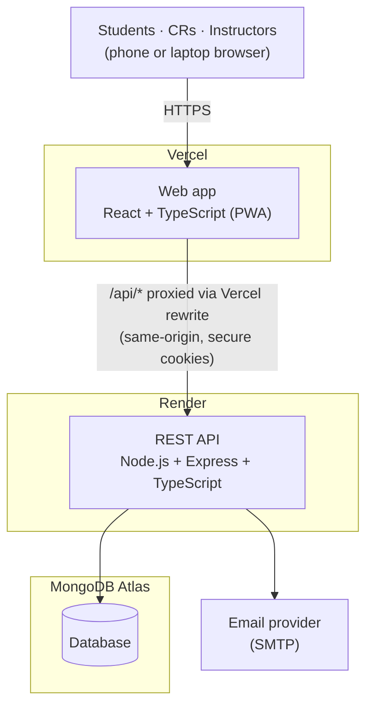

# Sabaq — Product Vision

> **Sabaq** (سبق, "lesson"): *your semester, in one calm place.*
> HCI Semester Project (Complex Computing Problem) · BSCS 5-1 · Riphah International University · Fall 2026

This document explains **what** Sabaq is, **why** it should exist, and **what is new** about it.
The step-by-step build plan is in [01-module-plans.md](01-module-plans.md).

---

## 1. The real-world problem

At most Pakistani universities, the information students need about their coursework is scattered across channels that were never designed for it:

| What a student needs to know | Where it lives today |
| --- | --- |
| That a lab or assignment was announced | A WhatsApp class group, buried under replies |
| The deadline | Moellim (LMS), a chat message, or said verbally in class |
| How to submit (file name `LabNO_SAPID_Class`, format, channel) | Page 2 of a PDF lab manual |
| The penalty for getting it wrong | Usually 10% of the marks, sometimes zero |
| That three other courses are due the same week | Nowhere |

**What happens as a result** (these are *hypotheses* that Phase 1 user research must confirm or reject):

1. Students miss deadlines or learn about them late, because an announcement was one line in a busy chat.
2. Students lose marks for avoidable mistakes: wrong file name, wrong format, late upload, emailing instead of uploading.
3. Students cannot see a "crunch week" coming until they are already in it.
4. Instructors cannot see the load other courses place on the same class, so deadlines pile up on the same days.
5. CRs and instructors never know whether an announcement actually reached the class.

### The HCI diagnosis

| Course concept | How it shows up in the problem |
| --- | --- |
| Norman's **gulf of evaluation** (L05) | Students cannot tell the current state of their semester |
| Norman's **gulf of execution** (L05) | The correct submission steps are hidden in PDFs |
| **Recognition over recall** (L04, Nielsen #6) | Students must remember rules instead of being shown them |
| **Error prevention** (Nielsen #5, L13 "do not set the user up") | Mistakes are discovered only after marks are lost |
| **Attention** (L04) | Important messages compete with chat noise |

## 2. The product

**Sabaq is a full-stack web application (installable on phones as a PWA).** It turns scattered course communication into one structured, trustworthy view of the semester for students, and gives instructors and CRs a reliable way to deliver information.

### Core features

| # | Feature | What it does | HCI principle it applies |
| --- | --- | --- | --- |
| 1 | **Today and Timeline** | Every deadline, quiz and class across all courses, ordered by urgency | Visibility of system status · recognition over recall |
| 2 | **Structured Announcements** | One post by a CR or instructor becomes a typed item (deadline, venue change, material, cancellation) in every student's timeline | Match with the real world · consistency |
| 3 | **"Seen by" receipts** | The sender sees "42 of 50 students have seen this" | Feedback · closes the gulf of evaluation for the *sender* |
| 4 | **Paste-to-Structure Assistant** | The CR pastes a WhatsApp-style message; Sabaq extracts the date, time, course and rules into a draft to confirm | Task migratability (L13) · fits existing habits |
| 5 | **Submission Checker** | The student drops in their file before uploading to Moellim; Sabaq checks its name, type, size and the time left against the assignment's rules | Error prevention · help users recover from errors |
| 6 | **Workload Heatmap** | Shows crunch days and weeks in advance | Forest + trees overview (L13) |
| 7 | **Deadline-Clash Warning** | When an instructor sets a deadline, Sabaq warns if the class is already loaded that day and suggests lighter days | Error prevention at the *system* level |
| 8 | **Planner** | Drag tasks into study slots (with a keyboard alternative) | Direct manipulation (L03) · substitutivity |
| 9 | **Study Group Finder** | Create or join study groups per course, matched by time and topic | Task conformance · social context |
| 10 | **Notifications and Focus Mode** | Batched digests, quiet hours, no interruptions while studying | Attention management (L04) |
| 11 | **Personalization and Accessibility** | Light, dark and high-contrast themes; font scaling; density; reduced motion; English and Urdu (right-to-left); full keyboard and screen-reader support | Customizability (L13) · CLO 3.1 design for age and disabilities |
| 12 | **Command Palette** (`Ctrl+K`) | Jump anywhere or do anything by typing | Flexibility and efficiency of use · accelerators for experts |

### What Sabaq deliberately does *not* do

Recorded as design rationale, so that scope decisions are explicit:

- It does **not** replace Moellim. Students still upload final files there; Sabaq checks them first.
- It does **not** read WhatsApp. Neither WhatsApp nor Moellim offers an API we may use. The paste assistant bridges the gap instead.
- It does **not** store grades.

## 3. What is new

Calendars, to-do apps and learning management systems already exist. What none of them do:

| Existing tool | What it misses |
| --- | --- |
| Moellim / Google Classroom | Only knows its own items; knows nothing about chat announcements or other courses' load; never checks file naming before upload |
| WhatsApp groups | No structure, no deadlines, no search; important messages get buried |
| Todoist / Notion / Google Calendar | Everything is entered by hand, which is exactly the effort students skip |

**Sabaq's five new ideas:**

1. **Write once, everyone gets it right**: one structured announcement fills every student's timeline automatically.
2. **Submission rules checked before upload**: error prevention moved to *before* the mistake.
3. **Deadline-clash warning for instructors**: the class's load across *all* courses becomes visible to the person setting the deadline.
4. **Paste-to-structure**: meets classes where they already communicate instead of forcing a habit change.
5. **"Seen by" receipts**: the sender finally knows whether information arrived.

> **One-line pitch:** *Individual pieces exist, but no product connects how Pakistani university classes actually communicate (CR + WhatsApp + LMS) into one structured system that prevents submission errors before they happen and helps instructors avoid overloading students.*

The claim that Sabaq improves real life must be **proven**. Phase 6 compares Sabaq against the current WhatsApp + Moellim workflow with real students, measuring task time, error rate and System Usability Scale (SUS) score.

## 4. Users and roles

| Role | Type | What they do in Sabaq |
| --- | --- | --- |
| **Student** | Primary user | Joins a class with a code; uses the timeline, Submission Checker, planner and study groups |
| **CR** (Class Representative) | Secondary user | Posts and maintains announcements for the class |
| **Instructor** | Secondary user | Posts deadlines with submission rules; sees receipts and clash warnings |
| **Admin** | Operator | Manages the institution's programs, classes and users |

Other stakeholders: students with visual or motor impairments, students new to campus, and the university (fewer disputes over missed deadlines).

## 5. Architecture



**Why the `/api` proxy matters:** the frontend (Vercel) and backend (Render) live on different domains. Browsers increasingly block cross-site cookies, which would break login. A Vercel rewrite makes `/api/*` look same-origin, so the secure httpOnly refresh-token cookie works everywhere, including Safari.

**Known constraint:** Render's free tier sleeps after 15 minutes idle, and the first request can take about 50 seconds. That is an HCI problem (responsiveness, L13). Mitigation: the web app pings the API as soon as the landing page loads, shows an honest "waking the server" status instead of a frozen screen, and keeps an offline cache of the timeline.

## 6. Technology stack

Exact versions are pinned at install time in each module.

| Layer | Choice | Why |
| --- | --- | --- |
| Monorepo | npm workspaces (`apps/*`, `packages/*`) | One repo, shared types, no extra tooling to install |
| Language | TypeScript everywhere | Type errors are caught before runtime |
| Shared | `packages/shared`: Zod schemas and domain logic | Frontend and backend validate with the *same* rules; the submission checker, clash detection and paste parser are tested once |
| Frontend | React + Vite + React Router + TanStack Query | Fast, modern, well supported |
| UI | Tailwind CSS + Radix UI primitives + design tokens | Accessible components (keyboard, ARIA) with a consistent style guide |
| Forms | react-hook-form + Zod | Inline validation with clear error messages |
| Interaction | dnd-kit (accessible drag and drop), cmdk (command palette), sonner (toasts with undo) | Direct manipulation with keyboard alternatives |
| i18n | i18next (English + Urdu, RTL) | Local audience and accessibility |
| Backend | Node.js + Express + TypeScript | Simple, proven, easy to deploy on Render |
| Database | MongoDB Atlas + Mongoose | Cloud database with a free tier |
| Auth | Short-lived access token + rotating refresh token in a secure httpOnly cookie; Argon2id password hashing | Secure sessions without storing tokens in localStorage |
| Email | Nodemailer over SMTP (Brevo free tier recommended) | Email verification and password reset |
| Testing | Vitest, Supertest, mongodb-memory-server, Playwright, axe-core | Unit, API, end-to-end and accessibility tests |
| CI/CD | GitHub Actions → Vercel (web) + Render (API) | Every push is checked; main branch is deployed |

## 7. Repository structure

```text
Sabaq/
├── apps/
│   ├── web/              React frontend (deployed to Vercel)
│   └── api/              Express backend (deployed to Render)
├── packages/
│   └── shared/           Types, Zod schemas, domain logic shared by web and api
├── docs/
│   ├── 00-vision-and-plan.md      this file
│   ├── 01-module-plans.md         the 30-module build plan
│   ├── research/                  Phase 1: instruments, anonymized data, synthesis
│   ├── design/                    Phase 2–3: personas, HTA, concepts, IA, wireframes
│   ├── design-rationale/          QOC decision records (Lab 11)
│   ├── testing/                   Phase 4 and 6: test plans, reports, metrics
│   └── design-system/             style guide
└── .github/              CI workflows, issue and pull-request templates
```

## 8. How the course maps onto the product

| Course content | Where it appears |
| --- | --- |
| Goals of HCI: safety, utility, effectiveness, efficiency, usability, appeal (L01–02) | Usability targets (M09), summative metrics (M29) |
| Interaction styles: command line, menu, form, WIMP, direct manipulation (L03, Lab 3) | Command palette, menus, forms, drag-to-plan |
| Cognition: attention, perception, memory, recognition vs recall (L04, Lab 4) | Timeline, focus mode, Submission Checker |
| Norman's seven stages, gulfs, mental vs conceptual models (L05, Lab 6) | Problem framing, conceptual model (M11) |
| Design process, user-centered design, ISO 9241-210, LUCID (L06) | The whole module structure |
| Personas, goals, contextual inquiry, HTA (L08–10, Lab 9) | M02, M08, M09 |
| Learnability, flexibility, robustness principles (L12–13) | Acceptance checks for every feature module |
| Design rationale, QOC, prototyping fidelity, paper prototyping (L14, Labs 5 and 11) | M10, M11, design-rationale records |
| Nielsen's 10 heuristics, usability engineering (Labs 7–8) | M12, M28, M29 |
| Evaluation with users: criteria, contexts, participants (Lab 10) | M12, M29 |

**CCP attributes covered:** requirements initially unknown (M02, M08); 5–7 diverse stakeholders (M02, M09); depth of analysis (M12, M29); conflicting requirements (M10 and the QOC records).

## 9. Ground rules

1. **No invented research data.** Lecture 08 says personas must come from real research. Interviews, observations, surveys and test sessions are run by the team with real students; the repository provides every instrument and analysis template.
2. **One module = one focused, verified commit**, pushed only when its Definition of Done passes.
3. **From M03 onward, nothing is pushed unless** formatting, lint, type checks and tests all pass (enforced by CI).
4. **Every major design decision gets a QOC record** in `docs/design-rationale/`.
5. **The repository tells the truth**: the README and CHANGELOG describe what actually exists, never what is only planned.
