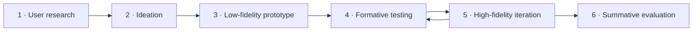

# Sabaq documentation

The design process is documented here, phase by phase. In HCI "the process is everything", so these documents are as important as the code.

| Document or folder | Contents | Module |
| --- | --- | --- |
| [00-vision-and-plan.md](00-vision-and-plan.md) | Problem, product, what is new, users, architecture, stack | M01 |
| [01-module-plans.md](01-module-plans.md) | Detailed plan and Definition of Done for all 30 modules | M01 |
| [research/](research/README.md) | Phase 1: research instruments, anonymized data, synthesis | M02, M08 |
| [design/](design/README.md) | Phases 2–3: personas, task analysis, concepts, information architecture, wireframes | M09–M11 |
| [design-rationale/](design-rationale/README.md) | QOC records explaining every major decision | from M02 |
| [testing/](testing/README.md) | Phases 4 and 6: test plans, reports, accessibility audit, summative metrics | M12, M28, M29 |
| [design-system/](design-system/README.md) | Visual language and style guide | M13 |

## Six-phase process

