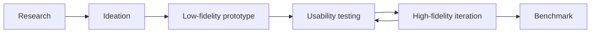

# Documentation

Sabaq is designed with its users, and the design process is documented here alongside the code.

| Document or folder | Contents |
| --- | --- |
| [vision.md](vision.md) | The problem, the product, what is new, users, architecture and technology |
| [roadmap.md](roadmap.md) | The 30 milestones, with deliverables and completion criteria |
| [data-model.md](data-model.md) | Collections, relationships, indexes and the demo data |
| [guides/](guides/mongodb-atlas.md) | Setup guides: [MongoDB Atlas](guides/mongodb-atlas.md), [e-mail with Brevo](guides/email-brevo.md) |
| [research/](research/README.md) | User research: plan, instruments, anonymized data and synthesis |
| [design/](design/README.md) | Personas, task analysis, concepts, information architecture and wireframes |
| [design-rationale/](design-rationale/README.md) | Records explaining every significant design decision |
| [testing/](testing/README.md) | Usability test plans and reports, accessibility audits and benchmarks |
| [design-system/](design-system/README.md) | Tokens, themes, personalization, components and their accessibility evidence |

## Design process

