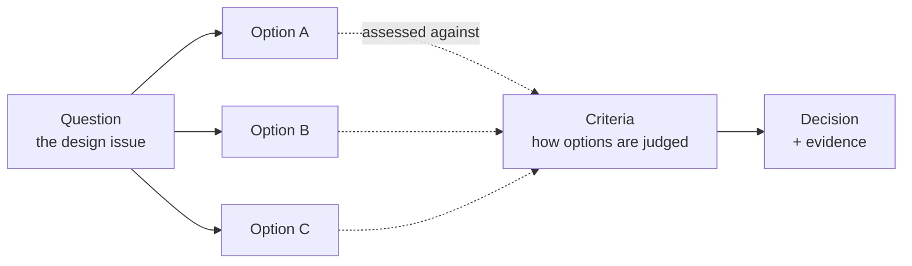

# Design Rationale

Significant design decisions are recorded here, so that anyone can understand **why** Sabaq works the way it does, and so that decisions can be revisited when new evidence arrives.

## Format

Each record follows the **Question–Option–Criteria (QOC)** method:

- **Question:** the design issue, phrased as a question.
- **Options:** genuinely different answers, including ones we expect to reject.
- **Criteria:** how options are compared, both positive (what we want) and negative (what we must avoid), ideally traced to research or usability targets.
- **Assessment:** how each option fares against each criterion.
- **Decision:** the choice, the evidence behind it, its consequences, and what would make us revisit it.

Start new records from the [template](template.md). Number them sequentially and never delete one: if a decision changes, mark the old record **Superseded** and link to the new one.

## Records

| ID | Question | Status |
| --- | --- | --- |
| [DR-001](DR-001-platform.md) | Which platform should Sabaq be built on? | Accepted (provisional, pending research) |
