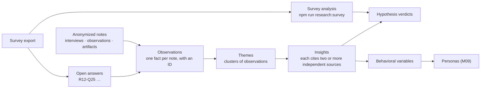

# Research synthesis

This folder turns raw fieldwork into evidence that design decisions can cite. **Status: awaiting fieldwork data.** The structure, rules and tools are ready, and findings are added as data arrives. Nothing here is written before the data exists.

## Process

1. **Anonymize** every note before it enters [`data/`](../data/README.md), following [consent and privacy](../consent-and-privacy.md).
2. **Extract observations.** Write each fact, quote or behavior as one line in the [affinity map](affinity-map.md), with a reference ID.
3. **Cluster** observations into themes bottom-up, without starting from the hypotheses.
4. **State insights**: what a theme means for design. Every insight lists its evidence.
5. **Analyze the survey** with `npm run research:survey`. This writes [`findings/survey-analysis.md`](../findings/README.md) and applies the pre-registered thresholds.
6. **Decide each hypothesis** in [hypotheses.md](hypotheses.md), combining the survey verdict with interview and observation evidence.
7. **Place participants** on the [behavioral variables](behavioral-variables.md). Clusters of participants become the personas in milestone 9.

## Evidence references

| Reference | Points to | Example |
| --- | --- | --- |
| `P<n>-<k>` | Observation *k* from student interview *n* | `P3-07` |
| `S<n>-<k>` | Observation *k* from staff or class representative interview *n* | `S1-02` |
| `O<n>-<k>` | Observation *k* from contextual inquiry session *n* | `O2-05` |
| `A<n>` | Collected artifact *n* (a redacted announcement or handout) | `A07` |
| `R<n>-Q<q>` | Survey response *n*, open question *q* | `R12-Q25` |

The source of a reference is its part before the first dash: `P3-07` and `P3-09` come from the same source; `P3-07` and `R12-Q25` are independent.

## Rules

- **Every insight cites at least two independent sources.** `npm run lint:research` enforces this in continuous integration.
- **Quotes are verbatim** and anonymized; paraphrases are marked as such.
- **Disconfirming evidence is recorded** next to supporting evidence, never dropped.
- **Thresholds are not changed after seeing data.** If a threshold turns out to be poorly chosen, the original verdict stays and the concern is noted.

## Commands

| Command | What it does |
| --- | --- |
| `npm run research:survey` | Validates `data/survey/responses.csv`, writes the survey report with charts and hypothesis verdicts, and lists any data problems |
| `npm run lint:research` | Checks that every insight in the affinity map has independent evidence |
