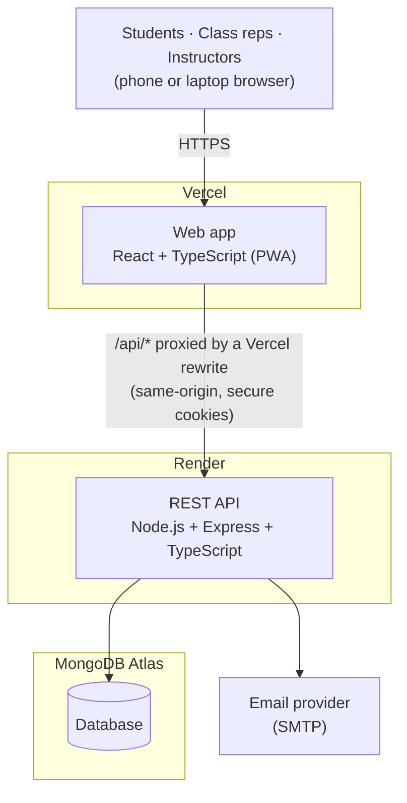

# Product Vision

> **Sabaq** (سبق, "lesson"): *your semester, in one calm place.*

This document explains **what** Sabaq is, **why** it should exist and **what is new** about it.
The build plan is in [roadmap.md](roadmap.md).

---

## 1. The problem

In many schools, colleges and universities, the information students need about their coursework is spread across channels that were never designed for it:

| What a student needs to know | Where it often lives today |
| --- | --- |
| That an assignment or lab was announced | A chat group (WhatsApp, Telegram …), buried under replies |
| The deadline | The learning management system (LMS), a chat message, or said verbally in class |
| How to submit (file name such as `Lab11_<StudentID>_<Section>`, format, channel) | A line inside a PDF handout |
| The penalty for getting it wrong | Lost marks, sometimes the whole submission |
| That several courses are due the same week | Nowhere |

**The likely consequences** (hypotheses that user research must confirm or reject):

1. Students miss deadlines or learn about them late, because an announcement was one line in a busy chat.
2. Students lose marks to avoidable mistakes: a wrong file name, the wrong format, a late upload, the wrong submission channel.
3. Students cannot see a crunch week coming until they are already in it.
4. Instructors cannot see the load other courses place on the same class, so deadlines pile up on the same days.
5. Whoever posts an announcement never knows whether it actually reached the class.

### Why this is a design problem

| Principle | How the current situation breaks it |
| --- | --- |
| **Visibility of system status** | Students cannot see the overall state of their term at a glance |
| **Recognition rather than recall** | Students must *remember* deadlines and rules instead of being shown them |
| **Error prevention** | Submission mistakes are discovered only after marks are lost |
| **Feedback** | Senders get no signal that information arrived |
| **Attention** | Important information competes with chat noise |

## 2. The product

**Sabaq is a full-stack web application, installable on phones and desktops as a Progressive Web App (PWA).** It turns scattered course communication into one structured, trustworthy view of the term for students, and gives instructors and class representatives a reliable way to deliver information.

| # | Feature | What it does | Design principle |
| --- | --- | --- | --- |
| 1 | **Today and Timeline** | Every deadline, quiz and class across all courses, ordered by urgency | Visibility · recognition over recall |
| 2 | **Structured Announcements** | One post becomes a typed item (deadline, venue change, material, cancellation) in every student's timeline | Match with the real world · consistency |
| 3 | **"Seen by" receipts** | The sender sees "42 of 50 students have seen this" | Feedback |
| 4 | **Paste-to-Structure Assistant** | Paste a chat-style message; Sabaq extracts date, time, course and rules into a draft to confirm | Fits existing habits · the system suggests, the human decides |
| 5 | **Submission Checker** | Before uploading to the LMS, the student drops in the file; Sabaq checks name, type, size and time left against the assignment's rules, entirely in the browser | Error prevention · clear recovery |
| 6 | **Workload Heatmap** | Shows crunch days and weeks in advance | Overview first, details on demand |
| 7 | **Deadline-Clash Warning** | When an instructor sets a due date, Sabaq shows the class's existing load that day and suggests lighter days | Error prevention at the system level |
| 8 | **Planner** | Drag tasks into study slots, with a full keyboard alternative | Direct manipulation · multiple ways to act |
| 9 | **Study Group Finder** | Create or join study groups per course, matched by time and topic | Supports the real task |
| 10 | **Notifications and Focus Mode** | Batched digests, quiet hours, no interruptions while studying | Respect for attention |
| 11 | **Personalization and Accessibility** | Light, dark and high-contrast themes; font size; density; reduced motion; multiple languages with right-to-left support (English and Urdu first); full keyboard and screen-reader support | Customizability · inclusive design |
| 12 | **Command Palette** (`Ctrl+K`) | Jump anywhere or do anything by typing | Accelerators for expert users |

### Deliberate scope limits

- Sabaq does **not** replace the LMS. Students still upload final files there; Sabaq checks them first.
- Sabaq does **not** read chat apps. They offer no suitable API; the paste assistant bridges the gap instead.
- Sabaq does **not** store grades.

## 3. What is new

Learning management systems, calendars and to-do apps already exist. What they do not do:

| Existing tool | What it misses |
| --- | --- |
| LMS (Moodle, Google Classroom, Canvas …) | Knows only its own items; nothing about chat announcements or other courses' load; never checks file naming before upload |
| Chat groups | No structure, no deadlines, no search; important messages get buried |
| Calendars and to-do apps | Everything is entered by hand, which is exactly the effort students skip |

**Sabaq's five new ideas:**

1. **Write once, everyone gets it right**: one structured announcement fills every student's timeline automatically.
2. **Submission rules checked before upload**: error prevention moved to *before* the mistake.
3. **Deadline-clash warning for instructors**: the class's load across *all* courses becomes visible to whoever sets the next deadline.
4. **Paste-to-structure**: meets classes where they already communicate instead of demanding a habit change.
5. **"Seen by" receipts**: the sender finally knows whether information arrived.

> *Individual pieces exist. No product connects how classes actually communicate (class representatives, chat groups and an LMS) into one structured system that prevents submission errors before they happen and helps instructors avoid overloading students.*

Every claim of improvement will be **measured**: the usability benchmark milestone compares Sabaq against the current chat + LMS + PDF workflow on task time, error rate and System Usability Scale (SUS) score.

## 4. Users and roles

| Role | What they do in Sabaq |
| --- | --- |
| **Student** (primary user) | Joins a class with a code; uses the timeline, Submission Checker, planner and study groups |
| **Class representative** | Posts and maintains announcements for the class |
| **Instructor** | Posts deadlines with submission rules; sees receipts and clash warnings |
| **Admin** | Manages the institution's programs, classes and users |

Sabaq is designed for every learner, including people with visual or motor impairments, people using a second language, and people on low-end phones with slow connections.

## 5. Architecture



**Same-origin API proxy.** The web app and the API live on different hosts. Browsers increasingly block cross-site cookies, which would break login. A Vercel rewrite makes `/api/*` same-origin, so the secure httpOnly refresh-token cookie works in every browser.

**Cold starts.** Free-tier API hosting sleeps when idle, and the first request can take close to a minute. The web app wakes the API as soon as it loads, shows an honest "connecting" status rather than a frozen screen, and keeps an offline copy of the timeline.

## 6. Technology

Exact versions are pinned when each part is introduced.

| Layer | Choice | Why |
| --- | --- | --- |
| Monorepo | npm workspaces (`apps/*`, `packages/*`) | One repository, shared types, no extra tooling |
| Language | TypeScript everywhere, strict mode | Errors caught before runtime |
| Shared logic | `packages/shared`: Zod schemas and domain logic | Frontend and backend validate with the same rules; core logic is tested once |
| Frontend | React, Vite, React Router, TanStack Query | Fast, modern, well supported |
| UI | Tailwind CSS, Radix UI primitives, design tokens | Accessible components with a consistent visual language |
| Forms | react-hook-form + Zod | Inline validation with clear messages |
| Interaction | dnd-kit, cmdk, sonner | Accessible drag and drop, command palette, undoable toasts |
| Internationalization | i18next | Multiple languages, right-to-left layouts |
| Backend | Node.js, Express, TypeScript | Simple, proven, easy to host |
| Database | MongoDB Atlas with Mongoose | Managed cloud database |
| Authentication | Short-lived access token + rotating refresh token in an httpOnly cookie; Argon2id hashing | Secure sessions without tokens in browser storage |
| Email | Nodemailer over SMTP | Verification and password reset |
| Testing | Vitest, Supertest, mongodb-memory-server, Playwright, axe-core | Unit, API, end-to-end and accessibility tests |
| CI/CD | GitHub Actions → Vercel (web) and Render (API) | Every change is checked; `main` is deployed |

## 7. Repository structure

```text
Sabaq/
├── apps/
│   ├── web/              React frontend (Vercel)
│   └── api/              Express backend (Render)
├── packages/
│   └── shared/           Types, schemas and domain logic used by web and api
├── docs/
│   ├── vision.md         this document
│   ├── roadmap.md        the 30-milestone build plan
│   ├── research/         user research: plan, instruments, anonymized findings
│   ├── design/           personas, task analysis, concepts, information architecture, wireframes
│   ├── design-rationale/ decision records
│   ├── testing/          usability test plans, reports, accessibility audits, benchmarks
│   └── design-system/    visual language and style guide
└── .github/              CI workflows and templates
```

## 8. Principles

1. **Evidence over opinion.** Personas, requirements and claims come from real research with real users. Nothing is invented.
2. **Accessible by default.** Every feature works with a keyboard, a screen reader, large text, high contrast and right-to-left languages.
3. **The system suggests, the human decides.** Automation (parsing, clash warnings, checks) never acts without confirmation.
4. **Privacy first.** Files are checked in the browser and never uploaded; research data is anonymized.
5. **Honest documentation.** The repository describes what exists, never only what is planned.
